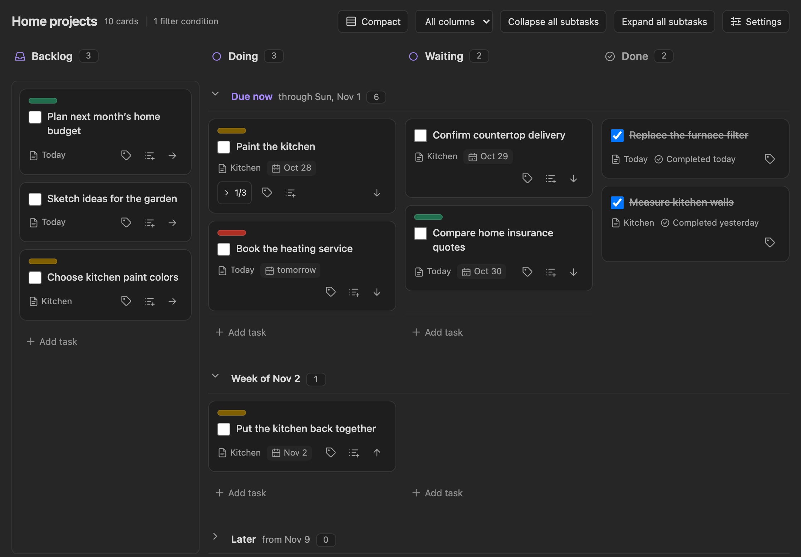
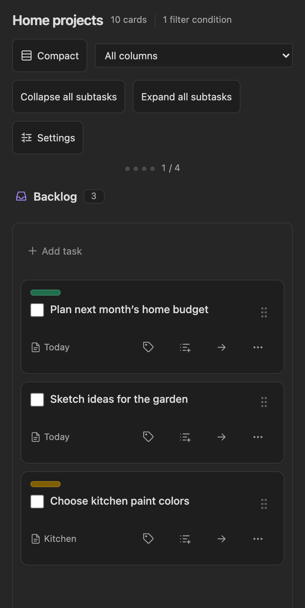

# Task Trellis

**A configurable kanban board for managing your tasks in Obsidian.**

Turn tasks scattered across your notes into a clear plan. See what’s in progress alongside what’s due, and build separate boards for work, home or any project. Task Trellis is designed to make adding and viewing tasks easy on your phone, with room to see the whole picture on desktop.

*Workflow columns show progress; date rows show what needs your attention next. Screenshots use sample tasks in the browser preview.*

## A board that fits the way you work

- **Bring your tasks together.** View tasks from across your vault, filtered by tags, folders or note properties. Each card links back to its source note.
- **Plan by progress and date.** Customize workflow columns, group tasks by due date, and drag cards to reschedule or move them forward.
- **Make priorities visible.** Use colored labels with names and colors unique to each board. Keep subtasks close, and collapse them when you want a simpler view.
- **Keep your notes as the source.** Tasks stay in Markdown. The same task can appear on several boards, with its own column and labels on each one.

## Made for your phone, too

Capture a task while it’s on your mind. **Add task** sits at the top of each mobile list, and the ready-made iOS shortcut lets you enter a task and optional due date for a chosen board.

View one column at a time, swipe between columns, and scroll through your tasks. Use the card’s **⋯** menu to move it, or its drag handle to reorder it. Compact view and collapsible subtasks help keep a busy board readable on a small screen.

[Set up the iOS shortcut →](docs/ios-shortcuts.md)

## Get started

[Install Task Trellis and create your first board](docs/getting-started.md), then choose which tasks belong on it and where new tasks should be saved. The **Tasks** plugin is optional; enable it for its task editor and recurring-task support.

| I want to… | Guide |
|---|---|
| Customize columns and due-date groups | [Board settings](docs/boards.md) |
| Show the right tasks on each board | [Filters](docs/filters.md) |
| Add tasks, move cards or manage subtasks | [Tasks and cards](docs/tasks.md) |
| Create and assign colored labels | [Labels](docs/labels.md) |
| Capture tasks from an iPhone shortcut | [iOS Shortcuts](docs/ios-shortcuts.md) |

## Your vault stays yours

Task Trellis works locally, requires no account, and collects no telemetry. Your existing vault sync carries the task lines and board settings between devices. [Privacy and integrations](docs/privacy.md).

## Development and credits

[Build and test locally](docs/development.md) · [Release checklist](docs/releasing.md)

Task Trellis is licensed under the [MIT license](LICENSE). Portions of the sorting and filtering logic are adapted from [4D Eisenhower Matrix](https://github.com/krcaljaroslav/4D-eisenhower-matrix) by Jaroslav Krčál (MIT). The runtime also includes [monkey-around](https://github.com/pjeby/monkey-around) by PJ Eby (ISC). See [third-party notices](THIRD_PARTY_NOTICES.txt); all notices are embedded in the generated bundle.
