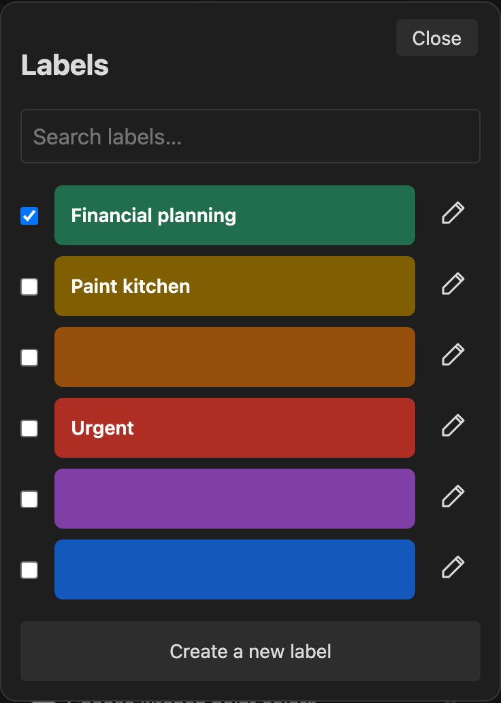

[← Task Trellis](../README.md)

# Use colored labels

Click or tap the **tag icon** on a main task card to open its label picker. Check one or more labels to assign them; uncheck a label to remove it. Selections save immediately. If enabled, the search box finds labels by name or color.

Each board starts with six unnamed labels: green, yellow, orange, red, purple and blue. Use a label’s **pencil** to name it or change its color, then choose the **green checkmark** at the top to save. Pick a color swatch or enter an HTML hex code such as `#FFCC00`. **+ Add label** adds another label to that board. Names are optional. Editing a label updates every card using it on that board.

Assigned labels appear as short colored bars above the card’s title. Hover to see a description such as **Red: Urgent**; custom colors use their hex code. On a phone, open the picker to see the labels’ names and selections. Subtasks do not have label controls or indicators.

Labels and assignments are independent on each board, even when the same task appears on several boards. Each assignment is an ordinary Obsidian tag, such as `#tt/personal-projects/label/3`. You can search for it in Obsidian or use it in a board's tag filters. Label tags do not change the task's column or sort order.

The final part is the label's permanent number on that board. Names can be as long as you like: renaming or recoloring a label keeps its number and tags unchanged. Each new label gets the next number, and the board note's `label-next` remembers it so a deleted label's number is never reused. Boards made before labels were numbered keep the IDs they started with, such as `red` or `l8f2a31`; those are permanent too, whatever the label's current name or color, and new labels there are numbered. The board note's `labels` properties map IDs to names and colors. Both the board definitions and task tags travel with your vault's sync. **Undo** reverses the latest assignment change.

Older hidden-comment assignments are still readable. Changing a task's selection rewrites that board's assignments as tags. There is no automatic vault-wide migration.

When editing a label, use the green checkmark at the top left to save, or the X at the top right to discard the edit and return to the picker. These controls stay above the scrolling fields while the phone keyboard is open. Checking labels in the picker still saves each selection immediately.

Label search is hidden by default. To show it, turn on **Settings → Task Trellis → Show label search**, then reopen the label picker. This preference applies to all boards.

## Choose a color scheme

Open a task’s labels, then choose **Color scheme** at the bottom. Select a scheme to preview your existing labels and use the **green checkmark** to apply it. The X returns without changing anything. Names, permanent IDs and task assignments stay the same.

Available schemes: **Trellis** (the original colors), **Tableau balanced**, **Tableau classic**, **Botanical**, **Mediterranean**, **Retro pop**, **Jewel box**, **Neon studio**, **Sorbet**, **Velvet** and **Modern primary**. Each has six colors; boards with more than six labels repeat those colors in label order.

Applying a different scheme saves each label’s exact outgoing color—including custom hex colors—as **Previous scheme**. Choose that entry and apply to restore it. The outgoing colors become the new Previous scheme, so you can switch back again. This single snapshot is stored in the board note and travels with sync. Renamed or reordered labels restore by permanent ID; newly added labels without a saved color stay unchanged, and deleted labels are not recreated. Applying unchanged colors keeps the existing snapshot.

The two Tableau options use six-color selections from [Tableau categorical palettes](https://help.tableau.com/current/pro/desktop/en-us/formatting_create_custom_colors.htm) and [Tableau 10](https://github.com/d3/d3-scale-chromatic/blob/main/src/categorical/Tableau10.js). The other alternatives are original palettes informed by [Wix’s color scheme examples](https://www.wix.com/blog/website-color-schemes).

When adding labels on multiple devices, let the board finish syncing first. The counter uses the latest local board contents; simultaneous offline additions on different devices can still conflict.
